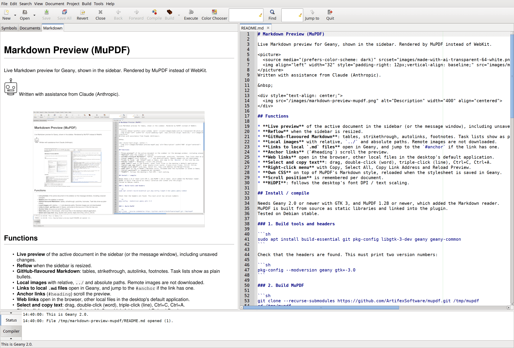

# Markdown Preview (MuPDF)

Live Markdown preview for Geany, shown in the sidebar. Rendered by MuPDF instead of WebKit.

<picture>
  <source media="(prefers-color-scheme: dark)" srcset="images/made-with-ai-transparent-64-white.png">
  
</picture>
Written with assistance from Claude (Anthropic).

<p align="center">
  
</p>

## Functions

* **Live preview** of the active document in the sidebar (or the message window), including unsaved changes.
* **Reflow** when the sidebar is resized.
* **GitHub-flavoured Markdown**: tables, strikethrough, autolinks, footnotes. Task lists show as plain bullets.
* **Local images** with relative, `../` and absolute paths. Remote images are not downloaded.
* **Links to local `.md` files** open in Geany, and jump to the `#anchor` if the link has one.
* **Anchor links** (`#heading`) scroll the preview.
* **Web links** open in the browser, other local files in the desktop's default application.
* **Select and copy text**: drag, double-click (word), triple-click (line), Ctrl+C, Ctrl+A. Lines that were only wrapped by the preview are copied as one line.
* **Right-click menu** with Copy, Select All, Copy Link Address and Reload Preview.
* **Own CSS** on top of MuPDF's Markdown style, reloaded when the stylesheet is saved in Geany.
* **Scroll position** is remembered per document.
* **HiDPI**: follows the desktop's font DPI / text scaling.

## Install / compile

You only need this repository and MuPDF. Geany Plugins is not required.

Needs Geany 2.0 or newer with GTK 3, and MuPDF 1.28 or newer, which added the Markdown reader.
MuPDF is built from source as static libraries and linked into the plugin.
Tested with MuPDF master (1.29.0) on Debian stable.

### 1. Build tools and headers

```sh
sudo apt install build-essential git pkg-config libgtk-3-dev geany geany-common
```

Check that the headers are found. This must print two version numbers:

```sh
pkg-config --modversion geany gtk+-3.0
```

### 2. Get the sources

Put both next to each other, in a new folder:

```sh
mkdir mdpreview-build
cd mdpreview-build
git clone --recurse-submodules https://github.com/ArtifexSoftware/mupdf.git
git clone https://github.com/MattiP451/markdown-preview-mupdf.git
```

If you download a GitHub zip of MuPDF instead of cloning, the `thirdparty/` folders are empty and
the build fails. Use `git clone --recurse-submodules`, or run
`git submodule update --init --depth 1` in a plain clone.

### 3. Build MuPDF

```sh
cd mupdf
make -j$(nproc) HAVE_X11=no HAVE_GLUT=no HAVE_CURL=no XCFLAGS="-fPIC -DTOFU -DTOFU_CJK" libs
```

`-fPIC` is required because a Geany plugin is a shared library. `-DTOFU -DTOFU_CJK` leaves out
MuPDF's large built-in fonts; drop them if you need CJK or other unusual glyphs.
Warnings from `thirdparty/extract` can be ignored.

MuPDF's makefile does not notice a change of `XCFLAGS`. If you built MuPDF before without `-fPIC`, linking the plugin
fails with `relocation R_X86_64_PC32 against symbol ... can not be used when making a shared object; recompile with -fPIC`.
Run `make clean` in the `mupdf` folder and build again with the command above.

### 4. Build the plugin

```sh
cd ../markdown-preview-mupdf/mdpreview
make -f Makefile.standalone MUPDF=../../mupdf/
```

### 5a. Install for yourself

```sh
make -f Makefile.standalone MUPDF=../../mupdf/ install
```

This copies `mdpreview.so` to `~/.config/geany/plugins/`.

### 5b. Or make a .deb

```sh
sh make-deb.sh
sudo apt install ./geany-plugin-mdpreview_*.deb
```

`make-deb.sh` expects MuPDF in `../../mupdf` (set `MUPDF=/path` otherwise) and records its exact
version and commit in the package, as the AGPL requires. It refuses to build if your MuPDF checkout
has local changes.

The package installs to Geany's system plugin folder and depends on the exact plugin
interface (`geany-abi-NNNNN`) of the Geany it was built against. After a Geany upgrade that
changes the interface, rebuild the plugin and the package. Set the version with
`VERSION=0.4 sh make-deb.sh`. Remove it with `sudo apt remove geany-plugin-mdpreview`.

Don't install both 5a and 5b, or the plugin appears twice in the Plugin Manager.

### Enable

Restart Geany, open Tools → Plugin Manager and tick **Markdown Preview (MuPDF)**.
Untick the old **Markdown** plugin to avoid two preview tabs.

### Optional: build inside geany-plugins

`mdpreview.patch` adds the plugin to a [geany-plugins](https://github.com/geany/geany-plugins) checkout
(tested against master, 2026-10-12):

```sh
git clone https://github.com/geany/geany-plugins
cd geany-plugins
patch -p1 < ../markdown-preview-mupdf/mdpreview.patch
./autogen.sh --with-mupdf=/path/to/mupdf
make && sudo make install
```

geany-plugins master currently requires Geany 2.1 or newer.

## Configuration

Edit → Plugin Preferences → Markdown Preview (MuPDF):

* **Show preview in**: Sidebar or Message window.
* **Base font size (pt)**: default 11. Scaled by the desktop's font DPI, so don't compensate for HiDPI here.
* **Background colour**: the area behind the document. Set it together with the text colour in the stylesheet for a dark preview.
* **Edit Stylesheet**: opens `preview.css` in Geany, creating it from a commented template on first use. Saving it updates the preview.

Files are in `~/.config/geany/plugins/mdpreview/`:

* `mdpreview.conf`: position, font size and background colour.
* `preview.css`: your CSS, applied on top of MuPDF's built-in Markdown style.

MuPDF understands roughly CSS 2.1: fonts, colours, margins, padding, borders, tables, lists.
It has no flexbox, grid or JavaScript.

Style links with `a:link`, not `a`. Every heading is also wrapped in an `<a id="...">`
anchor, so a plain `a` rule recolours headings as well.

Example for a dark preview, together with a dark background colour in the preferences:

```css
body { color: #d0d0d0; }
a:link { color: #6cb6ff; }
pre, code { background-color: #2d2d2d; }
blockquote { color: #a0a0a0; }
h1, h2 { border-bottom-color: #555; }
tr:nth-child(even) { background-color: #2a2a2a; }
```

Known limitations:

* Long unbreakable words in table cells don't wrap; a horizontal scrollbar appears instead.
* When copying, the plugin has to guess which line ends are only wrapping. A real line break (in code, or two spaces / `<br>` in text) is wrongly joined if the line ends within one word of the right edge of the preview, so that the next word wouldn't have fitted anyway.
* MuPDF's Markdown reader drops the last byte of its input. The plugin appends a newline to work around it.

## Prior art

* **[Geany Markdown plugin](https://plugins.geany.org/markdown.html)**, Matthew Brush, GPL-2.0-or-later (part of geany-plugins). The inspiration for this plugin: a Markdown preview in the sidebar or message window that follows the active document. The plugin structure follows it: the document and editor signals that trigger an update, and moving the preview tab between the sidebar and the message window. No code was copied; this plugin is written from scratch around MuPDF.
* **[MuPDF](https://github.com/ArtifexSoftware/mupdf)**, Artifex Software, Inc., AGPL-3.0-or-later. Linked into the plugin as a library, unmodified, and does all the work: Markdown to HTML (cmark-gfm), HTML and CSS layout, drawing, links and text selection. The plugin's own folder access for local images implements MuPDF's `fz_archive` interface with GLib, because MuPDF's `fz_open_directory` refuses `../` paths. No MuPDF code was copied.
* **[cmark-gfm](https://github.com/github/cmark-gfm)**, GitHub and John MacFarlane, BSD-2-Clause. The Markdown parser that MuPDF bundles.
* **[geany-plugins](https://github.com/geany/geany-plugins)**, GPL-2.0-or-later. The build files (`build/mdpreview.m4`, `Makefile.am`) follow the conventions and structure of the other plugins there.

## Licence

| What | Licence |
| --- | --- |
| Plugin source (`mdpreview/src`, build files, docs) | GPL-2.0-or-later, see [LICENSE](LICENSE) |
| MuPDF (linked into the compiled plugin) | AGPL-3.0-or-later, see [AGPL-3.0.txt](mdpreview/packaging/AGPL-3.0.txt) |
| Libraries, fonts and data bundled in MuPDF | see [THIRD-PARTY-NOTICES.txt](mdpreview/packaging/THIRD-PARTY-NOTICES.txt) |
| **The compiled `mdpreview.so` and the .deb** | **AGPL-3.0-or-later** (GPL-2.0-or-later plus AGPL-3.0 gives AGPL-3.0) |

Anyone who receives a compiled plugin is entitled to the source of both the plugin and the exact
MuPDF version it was built with. Each release attaches the MuPDF source it was built from, and the
.deb says which commit that is. Geany, GTK and GLib are only linked dynamically at run time.

Images: the screenshot is by the author. The "Made with AI" logo is by
[MattiP451](https://github.com/MattiP451/made-with-ai-logo), licensed under
[CC BY 4.0](https://creativecommons.org/licenses/by/4.0/) ([text](images/LICENSE-made-with-ai-logo-CC-BY-4.0.txt)).
The 64 px versions in `images/` are scaled-down copies of the original logo.
